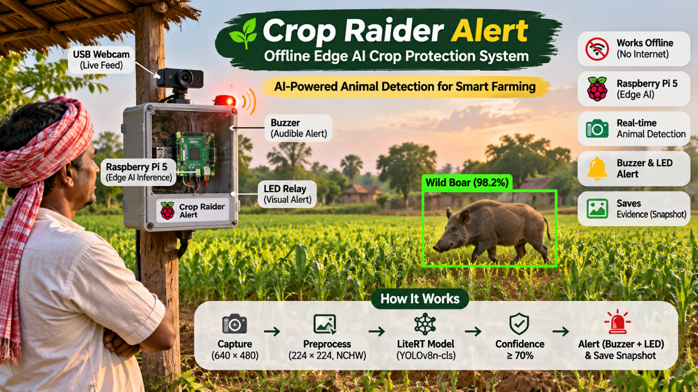

<p align="center">
  
</p>

<h1 align="center">Crop Raider Alert</h1>

<p align="center">
  Offline Edge AI-Powered Animal Classification<br>
  and Crop Protection System
</p>

> **Autonomous crop protection at the edge — no cloud connection required.**

The **Offline Edge AI Crop Raider Alert System** is a Raspberry Pi 5-based monitoring solution that detects crop-raiding animals from a live USB webcam stream. Each frame is processed locally with a LiteRT-compatible YOLOv8n classification model. High-confidence detections activate a buzzer and LED relay, while a timestamped image is saved for local review.

This project is designed for farms and remote field locations where reliable internet connectivity is unavailable, undesirable, or too expensive.

## Project highlights

- **Offline-first:** video, inference, alerts, and snapshots stay on the Raspberry Pi.
- **Edge inference:** no frame or prediction needs to leave the field.
- **Prediction-score gating:** predictions below 70% are ignored to reduce false alarms from people, shadows, tractors, and empty fields.
- **Physical alerting:** GPIO-controlled active buzzer and LED relay provide an immediate local warning.
- **Evidence capture:** valid events produce timestamped JPEG snapshots in local storage.
- **Safe shutdown:** camera and GPIO resources are released on `q` or `Ctrl+C`.
- **Simple deployment:** standard Python environment and Raspberry Pi OS Bookworm 64-bit.

## How it works

```text
USB webcam
    |
    v
OpenCV capture (640 x 480)
    |
    v
RGB conversion -> resize to 224 x 224 -> float32 normalization -> NCHW
    |
    v
LiteRT YOLOv8n classifier
    |
    v
Highest prediction score >= 70%?
    |                         |
   No                        Yes
    |                         |
 Ignore prediction       GPIO 18 buzzer + GPIO 23 LED relay
                              |
                              v
                    Save timestamped JPEG snapshot
```

The alarm has a configurable cooldown to prevent repeated alerts for the same continuous event. The system uses the highest-scoring class from the classifier output and validates that the model returns exactly 15 scores before continuing.

## Dataset

This project uses the [Animal Dataset with 15 Classes of Animals](https://www.kaggle.com/datasets/mkstar1/animal-dataset-with-15-classes-of-animals/data) from Kaggle.

- **Classes:** 15 animal categories
- **Total images used:** 9,084
- **Purpose:** training, validation, and testing of the animal classification model

Dataset attribution and licensing terms are provided by the original Kaggle publisher. Review those terms before redistributing the dataset or derivative assets.

## Training resources

The following resources make the dataset, training workflow, and deployment model available for inspection and reproduction:

| Resource | Link |
|---|---|
| Dataset | [Animal Dataset with 15 Classes of Animals – Kaggle](https://www.kaggle.com/datasets/mkstar1/animal-dataset-with-15-classes-of-animals/data) |
| Training notebook | [Open Google Colab notebook](https://colab.research.google.com/drive/1_4D-_kI7KrYNnb_NAQ9b9YUDVNu9p2MQ?usp=drive_link) |
| Trained model | [Download `crop_raider_model.tflite`](https://drive.google.com/file/d/1x775Y3WHO2uMQF8nvycQq1WDQwbUYugf/view?usp=drive_link) |

### Trained model details

- **Format:** LiteRT / TFLite
- **Input size:** 224 × 224
- **Classes:** 15
- **Filename:** `crop_raider_model.tflite`

If the model is downloaded separately, place it at:

```text
models/crop_raider_model.tflite
```

## Model and class contract

The application expects this local model file:

```text
models/crop_raider_model.tflite
```

The model is expected to accept a `float32` tensor shaped `[1, 3, 224, 224]` and return one score for each class below. The class order must remain identical to the alphabetical training-folder order:

```python
[
    "Armadilles",
    "Bear",
    "Birds",
    "Cow",
    "Crocodile",
    "Deer",
    "Elephant",
    "Goat",
    "Horse",
    "Jaguar",
    "Monkey",
    "Rabbit",
    "Skunk",
    "Tiger",
    "Wild Boar",
]
```

The supplied model achieved **96.4% validation Top-1 accuracy**. This is a validation result, not a claim about test-set or real-world field accuracy. The 70% runtime setting is a prediction-score rejection threshold; it does not provide guaranteed unknown-object detection or guarantee that every accepted prediction is correct.

## Training results

The classifier was trained for 10 epochs. The recorded training loss and validation Top-1 scores were:

| Epoch | Training loss | Validation Top-1 |
|---:|---:|---:|
| 1 | 1.6690 | 87.1% |
| 2 | 0.5159 | 93.1% |
| 3 | 0.3579 | 93.4% |
| 4 | 0.3062 | 94.3% |
| 5 | 0.2489 | 95.6% |
| 6 | 0.2058 | 96.3% |
| 7 | 0.1776 | 96.4% |
| 8 | 0.1631 | 95.9% |
| 9 | 0.1521 | 96.4% |
| 10 | 0.1422 | 96.4% |

### Dataset split summary

| Split | Images |
|---|---:|
| Training | 7,262 |
| Validation | 923 |
| Testing | 899 |
| **Total** | **9,084** |

- **Classes:** 15
- **Training folder order:** strict alphabetical order, matching the class contract above.

## Training reproducibility

Training was performed in Google Colab using a YOLOv8n classification workflow and exported to LiteRT for Raspberry Pi inference. The reproducibility configuration used by the project is:

```text
Task: image classification
Architecture: YOLOv8n-cls
Training epochs: 10
Input size: 224 x 224
Classes: 15
Export format: LiteRT (.tflite)
```

The [Google Colab training notebook](https://colab.research.google.com/drive/1_4D-_kI7KrYNnb_NAQ9b9YUDVNu9p2MQ?usp=drive_link) contains the dataset preparation, training workflow, evaluation output, and model export steps. The exported model is included at `models/crop_raider_model.tflite`.

## Hardware wiring

Power down the Raspberry Pi before wiring. Use a common ground, follow each module's voltage requirements, and use an appropriate transistor, driver, or opto-isolated relay for loads that exceed GPIO current limits.

| Device | Raspberry Pi connection | Software configuration |
|---|---|---|
| Active buzzer signal | GPIO 18, physical pin 12 | Active-high |
| Active buzzer power | Module-rated 5V or supply | Follow the module datasheet |
| Active buzzer ground | GND, for example physical pin 14 | Common ground |
| LED relay signal | GPIO 23, physical pin 16 | Active-high |
| LED relay power/ground | Module-rated supply and common GND | Use isolation where required |
| USB webcam | Any USB port | Camera index `0` by default |

> **Electrical safety:** never connect a high-current LED, motor, or other load directly to a Raspberry Pi GPIO pin. Verify whether the relay module is active-high or active-low before connecting it.

## Technology stack

| Layer | Technology |
|---|---|
| Edge computer | Raspberry Pi 5 |
| Operating system | Raspberry Pi OS Bookworm, 64-bit |
| Runtime | Python 3 |
| Vision pipeline | OpenCV and NumPy |
| Inference | LiteRT via `ai-edge-litert` |
| Hardware I/O | `gpiozero` |
| Model | YOLOv8n classification export, LiteRT format |

## Repository structure

```text
.
├── assets/
│   └── crop-raider-banner.png    # GitHub README project banner
├── main.py                         # Live camera, inference, GPIO, and snapshots
├── predict_image.py                # Laptop-friendly single-image smoke test
├── requirements.txt                # Python dependencies
├── setup_guide.md                  # Raspberry Pi installation and wiring guide
├── models/
│   └── crop_raider_model.tflite    # Local LiteRT model
└── test_images/
    └── download.png                # Example image for local testing
```

Runtime snapshots are written to `snapshots/` and are excluded from Git.

## Installation on Raspberry Pi

The complete hardware setup is documented in [setup_guide.md](setup_guide.md). The essential commands are:

```bash
sudo apt update
sudo apt full-upgrade -y
sudo apt install -y python3-venv python3-dev python3-opencv v4l-utils git

git clone https://github.com/sentiashish/crop-guard-edge-ai.git
cd crop-guard-edge-ai

python3 -m venv --system-site-packages cropenv
source cropenv/bin/activate
python -m pip install --upgrade pip
python -m pip install -r requirements.txt
```

Confirm that the webcam is visible:

```bash
v4l2-ctl --list-devices
```

Start the live system:

```bash
source cropenv/bin/activate
python main.py
```

Press `q` in the preview window or `Ctrl+C` in the terminal to stop the system safely.

## Laptop smoke test

The image test does not require Raspberry Pi GPIO hardware:

```bash
python predict_image.py
```

It loads `test_images/download.png`, runs the same 224x224 NCHW preprocessing and LiteRT model inference, and prints whether the result passes the 70% prediction-score threshold.

Verified local smoke-test output:

```text
===== CROP RAIDER PREDICTION =====
Animal Detected: Tiger
Confidence: 100.00% -> TRIGGER ALARM
```

## Configuration

Deployment settings are defined near the top of [main.py](main.py):

| Setting | Default | Purpose |
|---|---:|---|
| `CAMERA_INDEX` | `0` | USB camera index |
| `FRAME_WIDTH` / `FRAME_HEIGHT` | `640` / `480` | Capture resolution |
| `CONFIDENCE_THRESHOLD` | `0.70` | Minimum accepted probability |
| `ALARM_COOLDOWN_SECONDS` | `10.0` | Minimum time between alerts |
| `BUZZER_GPIO` | `18` | Buzzer BCM GPIO |
| `LED_RELAY_GPIO` | `23` | Relay BCM GPIO |

Change these values only after confirming the camera, model export, and physical wiring.

## Operational checklist

Before unattended operation:

1. Confirm the model file exists and matches the expected input/output contract.
2. Verify the webcam view in the actual field lighting.
3. Test the buzzer and relay with the load safely disconnected.
4. Confirm snapshots are being written to local storage.
5. Collect field examples and review false positives/negatives.
6. Tune the threshold and cooldown using measured field behavior.

## Troubleshooting

### `gpiozero` is underlined in VS Code

Select the project interpreter and install the dependencies in that environment:

```bash
python3 -m venv --system-site-packages cropenv
source cropenv/bin/activate
python -m pip install -r requirements.txt
```

In VS Code, choose `cropenv/bin/python` using **Python: Select Interpreter**.

### Camera cannot be opened

Check the USB connection and list available devices:

```bash
v4l2-ctl --list-devices
```

If the webcam is not index `0`, update `CAMERA_INDEX` in `main.py`.

### Model shape or class-count error

The model must accept `[1, 3, 224, 224]` float32 input and return 15 class scores. Re-export or replace the model if its input layout, dimensions, or class order differs.

## GitHub

Initialize and publish the repository from its root directory:

```bash
git init
git branch -M main
git add README.md setup_guide.md requirements.txt .gitignore main.py predict_image.py models/crop_raider_model.tflite
git commit -m "Initialise offline edge AI crop raider alert system"
git remote add origin https://github.com/sentiashish/crop-guard-edge-ai.git
git push -u origin main
```

If `origin` already exists:

```bash
git remote set-url origin https://github.com/sentiashish/crop-guard-edge-ai.git
git push -u origin main
```

## License

Add the license that matches the model, dataset, and source-code redistribution terms before publishing this repository publicly. Ensure that the trained model and any sample images are legally redistributable.
